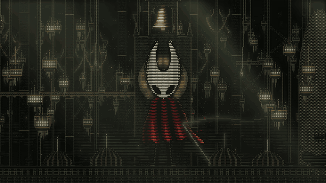
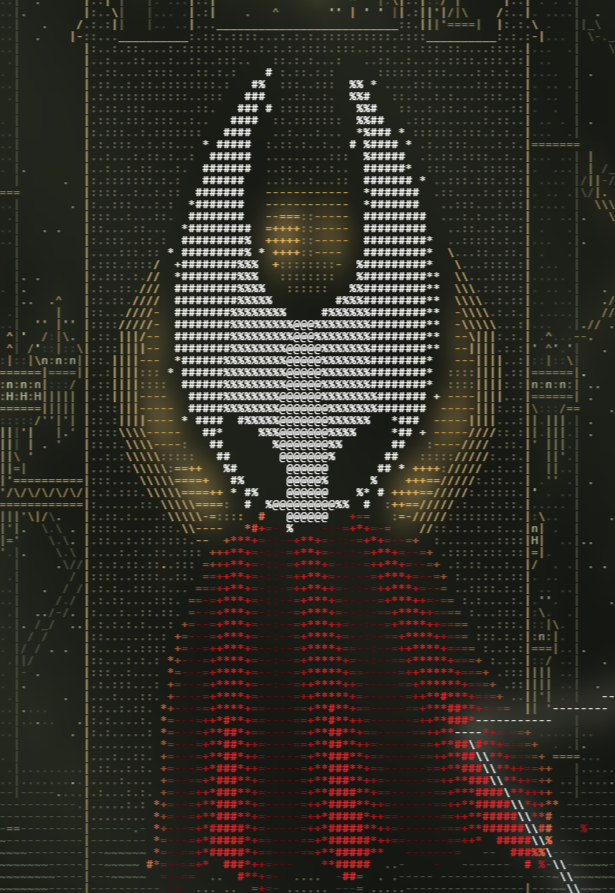
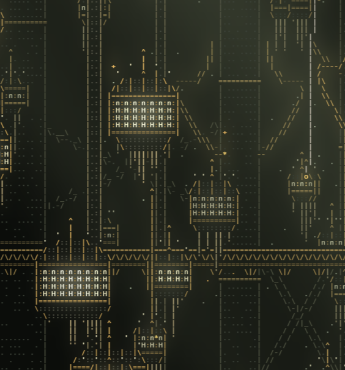
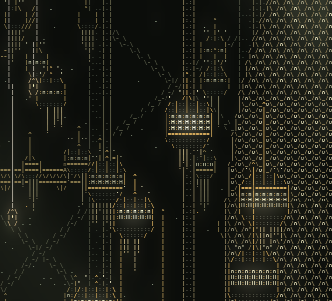
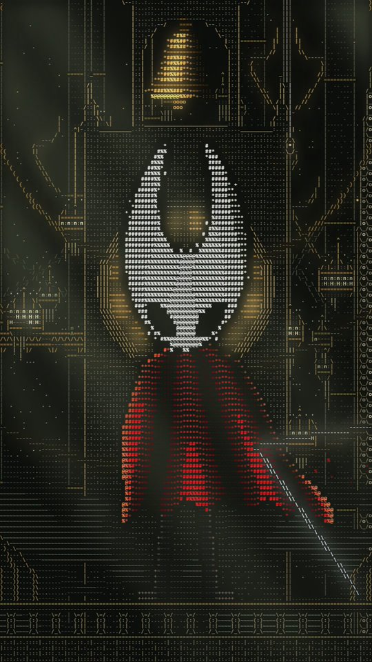

# ASCII Hornet



Animated **Hollow Knight: Silksong** fan art made entirely from text characters. Hornet, wearing her red cloak, watches the Citadel of Pharloom: hanging chandelier houses, colossal pillars, olive-green mist, and shafts of light.

## The scene

### Hornet



- **Mask:** Embedded in the HTML as a 7 KB PNG and converted to characters when the page loads. The face is the same white as the background, so the background is removed outward from the image edges, while the black outline protects the face.
- **Red cloak:** Features fan-shaped folds, a jagged hem, and golden rim lighting. It ripples in the wind and sheds small scraps of fabric.
- **Breathing:** Hornet gently breathes and sways, with her feet planted on the ledge.
- **Needle:** Extends from beneath the cloak, with a strand of silk trailing in the wind.
- **Halo:** The bell tower's rose window sits directly behind her head.

<br clear="right">

### The Citadel

<p>
  
  
</p>

| Feature | How it appears |
|---|---|
| Chandelier houses | Spiked domes `'`, golden bands `====`, arched windows `n` above `H`, and pendant fringe `\|` ending in `'`. They hang in clusters, with lower houses in front of higher ones. |
| Colossal pillars | Extend beyond the frame, with golden rings, X-shaped bracing, and curling golden ribbons. |
| Lattice bridge | Drawn with `/\/\/\`; a pilgrim (`n` above `A`) walks back and forth across it. |
| Honeycomb tower | Hexagonal cells `/ \_/` with glowing lights `o`, at the right edge. |
| Bell tower | An arched belfry with a swinging bronze bell and a rose window just below it. |
| Foreground | Dark domes with golden ribs and silver spires, behind a balustraded ledge. |
| Atmosphere | Olive mist rising from below, diagonal shafts of light from the upper left, sparks, and silk threads with hanging lanterns. |

The Citadel is based on reference images shared [in this r/HollowKnight post](https://www.reddit.com/r/HollowKnight/comments/1phbn1c/oc_i_built_a_certain_building_from_silksong_in/).

### Interaction

- **Bell ring:** Click, tap, press Space, or press Enter to jolt the bell, send out sound waves `( )`, light every window, and scatter sparks. The sound is synthesized in real time (eight inharmonic bell partials using Web Audio); there is no audio file.
- **Parallax:** City layers shift at different depths in response to mouse movement or phone tilt. On iPhone, gyroscope permission is requested on the first tap.
- **Reduced motion:** Visitors who have enabled the system's reduced-motion setting see a still frame.

### On mobile



The grid adapts to the screen's aspect ratio. In portrait mode, the bell tower and Hornet stay centered, while the chandelier houses and honeycomb tower appear at the sides. This uses the same framing as the TikTok video.

<br clear="right">

## How it works

1. **Grid:** The scene has 120 character rows, and the number of columns follows the screen's aspect ratio. The canvas is drawn at a fixed resolution, then scaled with CSS to fit the window.
2. **World:** Each cell maps to a point in world coordinates (`y` runs from 0 to 1, top to bottom; `x` is centered at 0). All shapes are functions of this coordinate space.
3. **Static city:** Built once per screen size in five layers (sky, distant, midground, foreground, and bell tower), with extra horizontal space for parallax. Edges are detected from the silhouettes, and each edge's direction selects a character: `|`, `/`, `\`, `_`, or `-`.
4. **Each frame:** Layers are composited with their offsets. Then these elements are added in order: window glow, bell, sound waves, pilgrims, mist, threads, sparks, foreground, and Hornet.
5. **Rendering:** Each character's alpha mask is rendered once, and frames are assembled pixel by pixel into an `ImageData` buffer. Drawing each cell with `fillText` was too slow: this change reduced frame time from about 90 ms to about 20 ms at 1920×1080 in tests.
6. **Glow:** Emissive cells and light beams are drawn to a small canvas, blurred, and composited beneath the text.
7. **Seamless loop:** Every animation completes an integer number of cycles in a 12-second loop. For the mist, two noise samples offset by one cycle are blended so the last frame transitions into the first.

## Run it

Open `index.html` in a browser. You can also serve the folder:

```bash
npx serve .
```

To deploy, upload the folder to Vercel (`npx vercel`) or Netlify. After deployment, replace the `og:image` value in the `<head>` with the image's full URL (`https://your-site/og.png`), since WhatsApp and Facebook do not accept a relative path for link previews.

## Customize

Settings are near the top of the `<script>` in `index.html`:

| Constant | What it changes |
|---|---|
| `ROWS` | Number of grid rows. More rows add detail and increase frame cost. |
| `FPS` | Animation frame rate. |
| `LOOP` | Loop duration, in seconds. |
| `WIND` | Wind strength for the cloak and mist. |
| `S` | Hornet's height as a fraction of the screen. |
| `BT` | How far the belfry extends above her horns. |
| `PAR` | Parallax amount for each layer, in columns. |
| `HEAD_SRC`, `HEAD_Y`, `HEAD_H` | Mask image, chin position, and height. |
| `STONE`, `GOLD`, `PALE`, `RED`, `FOG`… | Color palette. |

To replace the mask, use a PNG with dark outlines on a solid or transparent background. Generate the `HEAD_SRC` data URL with:

```bash
node -e "console.log('data:image/png;base64,' + require('fs').readFileSync('mask.png').toString('base64'))"
```

## Files

| File | Description |
|---|---|
| `index.html` | The complete site: scene, animation, sound, and embedded mask image. |
| `docs/` | Images used in this README. |

## Credits

- *Hollow Knight: Silksong* and its characters are © Team Cherry. This is non-commercial fan art and is not affiliated with Team Cherry.
- Citadel visual references came from [this r/HollowKnight post](https://www.reddit.com/r/HollowKnight/comments/1phbn1c/oc_i_built_a_certain_building_from_silksong_in/).